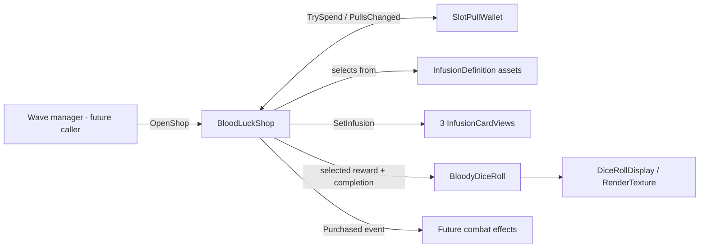

# BloodLuck Shop System Overview

## 1. System overview

The shop is a small, run-scoped upgrade picker. Each time `BloodLuckShop.OpenShop()` is called, it draws up to three distinct offers from the configured infusion pool and shows them as the three upgrade cards. It also shows a fourth **BLOODY DICE** card, which costs two slot pulls and guarantees one randomly selected Bloodwrought infusion.

`SlotPullWallet` provides the shared purchase currency. Normal infusion costs are derived from rarity: Bloodstained and Bloodbound cost one pull; Bloodwrought costs three. Bloody Dice always costs two pulls. The shop records owned non-stackable infusions, raises a purchase event for another system to apply the result, and controls the dice-overlay flow. The dice itself is presentation only: the shop has already selected the reward before the player presses **ROLL**.

The `Shop_Prototype` scene opens the shop at startup through its `ShopScriptTest` object. In the gameplay code, the wave manager currently continues to the existing perk selection after every finished wave; it does not yet open this shop.

## 2. Script responsibilities

| Script | Purpose, owned data, and connections | Important API |
| --- | --- | --- |
| `BloodLuckShop` | The controller. Owns the current offers, owned non-stackable infusions, dice state, pending dice reward, UI button wiring, and the configured `infusionPool`. Talks to `SlotPullWallet`, `InfusionCardView`, `ShopWalletView`, and `BloodyDiceRoll`. | `OpenShop()`, `CloseShop()`, `ResetForRun()`, `Buy(int)`, `BuyDice()`, `GetOffer(int)`; events `Purchased` and `Closed`. |
| `InfusionDefinition` | ScriptableObject data asset for one infusion: `displayName`, `description`, `icon`, and `rarity`. It derives `Cost` and `Stackable` (only Bloodstained is stackable). | `Cost`, `Stackable`; Create menu: **BloodLuck/Infusion**. |
| `SlotPullWallet` | Owns the current pull count and configured `startingPulls` (6 in the prototype). It validates and deducts spend requests. | `Pulls`, `PullsChanged`, `ResetForRun()`, `TrySpend(int)`. |
| `InfusionCardView` | Presentation for a normal offer card only. Writes the asset’s icon, name, rarity label, description, and cost into its assigned UI fields; it owns no purchase logic. | `SetInfusion(InfusionDefinition)`. |
| `ShopWalletView` | Displays one bound wallet as `PULLS: n`. Subscribes/unsubscribes to `PullsChanged`. | `Bind(SlotPullWallet)`. |
| `BloodyDiceRoll` | Visual-only coroutine sequence. Owns roll timing, bounce, face rotations, display references, and optional UnityEvents. It receives an already-selected reward, spins the dice to that reward’s stable asset-name-derived face, displays the name, then invokes completion. | `ShowDice()`, `HideDice()`, `Roll(reward, completed, hideDisplayAfterReveal)`; `IsRolling`. |
| `ShopPrototypeSetup` | Editor-only menu utility (**Tools/BloodLuck/Build Shop Prototype**). It creates/rewires the prototype UI and sample assets, and configures dice rendering. It is not gameplay runtime code. | `Build()` (menu command). |
| `ShopOpen` | Prototype-only startup helper on `ShopScriptTest`; its `Start()` immediately calls the assigned shop’s `OpenShop()`. | None public. |

## 3. How the systems connect

`BloodLuckShop` owns offer selection, spending decisions, the owned set, and granting notifications. `SlotPullWallet` alone owns the numeric currency. `InfusionDefinition` assets own display/configuration data. Card and wallet views only display that data. `BloodyDiceRoll` only presents a reward selected by the shop; it does not choose or grant it.

At open, the controller filters the pool through `AvailableInfusions()`, then makes weighted, non-repeating offers for that opening: Bloodstained weight 5, Bloodbound 2, Bloodwrought 1. A normal card remains empty after purchase. A dice purchase chooses uniformly from the currently available Bloodwrought assets, not from the weighted card selection.

The future integration point is deliberately public: the wave flow (or a bridge component) calls `OpenShop()`, subscribes to `Closed` to resume its flow, and subscribes to `Purchased` to apply an upgrade. The current `BloodLuckWaveManager` does neither. Although `WaveFinishedAndVisitingShop` exists as an async-task type, `BloodLuckGameUpdateLoopManager` does not handle it; wave completion queues `WaveFinishedAndSelectingPerk` instead.

## 4. Unity Editor setup (`Shop_Prototype`)

The scene uses these root objects: `ShopSystem`, `ShopScriptTest`, `UICanvas`, `DiceRollRoot`, `DiceCamera`, `Main Camera`, and `EventSystem` (plus prototype world objects). `ShopSystem` contains `BloodyDiceRoll`, `BloodLuckShop`, and `SlotPullWallet`; its wallet starts at 6 pulls. `ShopScriptTest` contains `ShopOpen` with its `shop` reference assigned to `ShopSystem`’s `BloodLuckShop`.

`UICanvas` is a **Screen Space - Overlay** canvas with `GraphicRaycaster` and a `CanvasScaler` set to **Constant Pixel Size**. Its two children are:

- `ShopPanel`: `Image`, containing `Title`, `PullCounter` (`TMP_Text` + `ShopWalletView`), `UpgradeCard1`, `UpgradeCard2`, `UpgradeCard3`, `BloodyDiceButton`, and `LeaveShopButton`. Each upgrade card has `Image`, `Button`, and `InfusionCardView`, with `Name`, `Rarity`, `Description`, and `Cost` TMP children. All three `icon` fields are currently unassigned; the configured sample infusion icons are also unassigned.
- `DiceOverlay` (inactive in the saved scene): full-canvas `Image` containing `GothicPanel`, `RollBoardFrame`, `RollBoard`, `DiceRollDisplay`, `Heading`, `Instruction`, `RollButton`, and `ReturnButton`. `DiceRollDisplay` is an inactive `RawImage` with child `RewardLabel`.

In the `BloodLuckShop` Inspector, the panel, three card buttons/views, `BloodyDiceButton`, `LeaveShopButton`, `PullCounter`’s `ShopWalletView`, all dice overlay controls, and the `ShopSystem` wallet/dice components are assigned. Its pool is, in scene order: `Vitality`, `Rending Claws`, `Crimson Nova`, `Nightfall`, and `Blood Engine` from `Assets/Data/Infusions/`.

`DiceRollRoot` is on layer 6 (**DiceUI**) at world origin and parents the `Bloodluck_Dice_D6` prefab. `DiceCamera` is an orthographic camera at `(0, 0, -5)`, culls only layer 6 (mask value 64), and writes to `Assets/Art/Dice/DiceRenderTExture.renderTexture` (the project asset’s spelling). `DiceRollDisplay` reads that same RenderTexture. `Main Camera` excludes layer 6 (its mask is all layers except DiceUI), so the dice is not drawn into the main view. The DiceCamera audio listener is disabled. This isolates the 3D dice render and embeds it in the UI RawImage.

## 5. Gameplay flow

**Normal infusion:** Open shop -> controller selects offers -> select a card -> `TrySpend(Cost)` deducts pulls -> shop calls `Grant()` -> records a non-stackable asset as owned and invokes `Purchased` -> that slot is cleared.

**Bloody Dice:** Select BLOODY DICE -> `TrySpend(2)` -> shop uniformly selects an available Bloodwrought reward -> opens `DiceOverlay` and enables **ROLL** -> press **ROLL** -> `BloodyDiceRoll` animates and reveals the selected name -> completion grants the reward -> **RETURN TO SHOP** becomes available -> return hides the overlay and refreshes cards.

Non-stackable assets (Bloodbound and Bloodwrought) are removed from future offers and dice candidates once granted. Bloodstained assets are intentionally stackable, so they may be purchased repeatedly. While a dice purchase is active, all shop choices and leaving are disabled; `diceHasRolled` and `diceRewardGranted` prevent repeat roll/grant calls for that purchase.

## 6. How to extend the system

- **Create an infusion:** In the Project window choose **Create > BloodLuck > Infusion**, then set its name, description, icon, and rarity. Alternatively create an asset under `Assets/Data/Infusions/`.
- **Add it to the shop:** Select `ShopSystem`, add the asset to `BloodLuckShop > Infusion Pool`. It becomes eligible for normal offers; if it is Bloodwrought, it is also eligible for Bloody Dice.
- **Change display data:** Edit that `InfusionDefinition` asset. `InfusionCardView` reads the values each time the shop refreshes; rarity also determines cost and whether it stacks.
- **Open from code:** hold a `BloodLuckShop` reference and call `shop.OpenShop();`. Use `shop.Closed += ...` for the continuation and `shop.Purchased += infusion => ...` to apply the eventual gameplay effect.
- **Connect waves:** change the wave completion path to open the assigned shop and resume on `Closed`. The current wave loop has no shop reference/bridge and still waits for perk selection instead.
- **Replace placeholder artwork:** assign sprites to `InfusionDefinition.icon` assets and assign an `Image` to each card view’s `icon` field. Replace the prototype `Image` colors/UI elements and dice display artwork as needed without changing controller references.

Individual combat upgrade effects are **not implemented in this shop code**. The `Purchased` event provides the handoff, but no current subscriber applies Vitality, Rending Claws, or the other sample infusion descriptions to combat.

## 7. Current limitations

- Infusion purchases only record ownership and raise `Purchased`; no combat/stat effects are implemented here.
- Wave 5/shop integration is incomplete: current wave completion goes to perk selection, not the shop. No wave-number-specific shop trigger is implemented in the inspected code.
- The slot-pull wallet is a counter only; there is no final slot-machine earning/spin system in this implementation.
- UI uses prototype colored panels and blank infusion icons; dice uses a simple RenderTexture presentation. Final art, audio/event hooks, and broader visual polish remain deferred.
